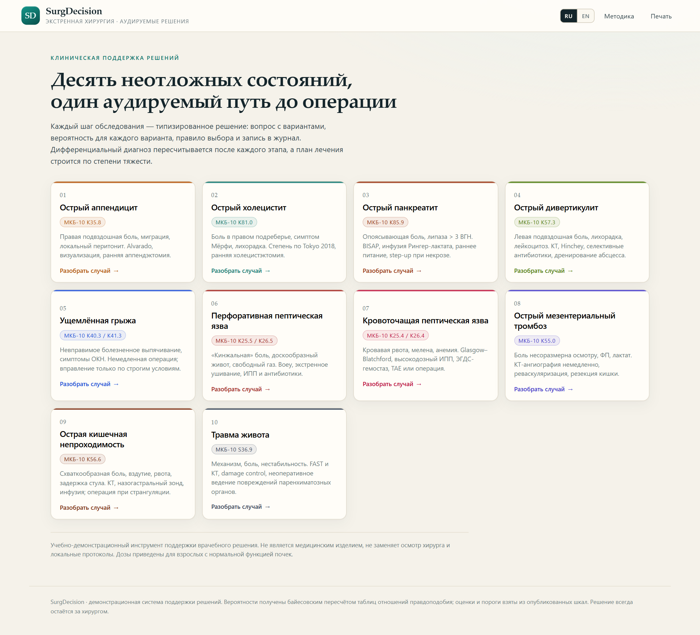
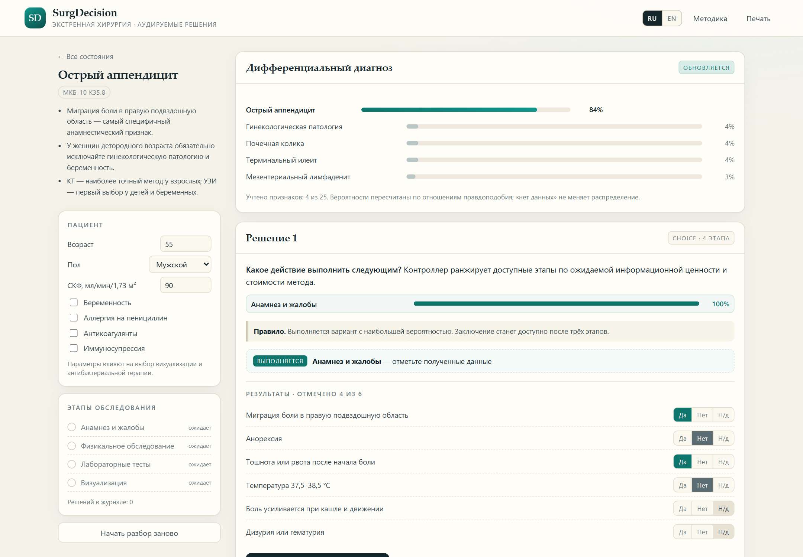
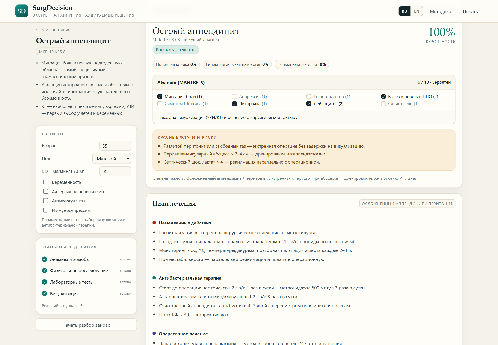
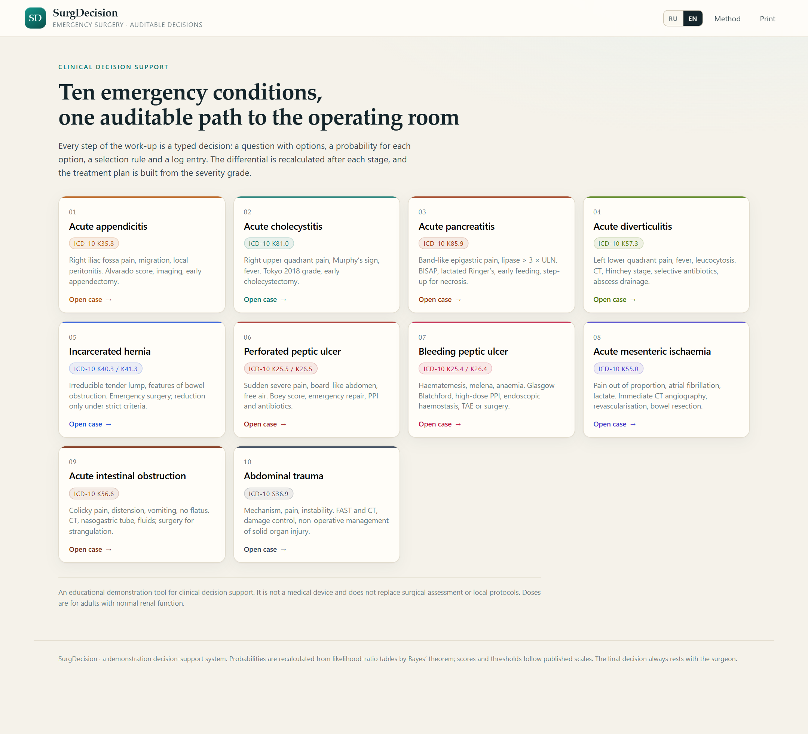
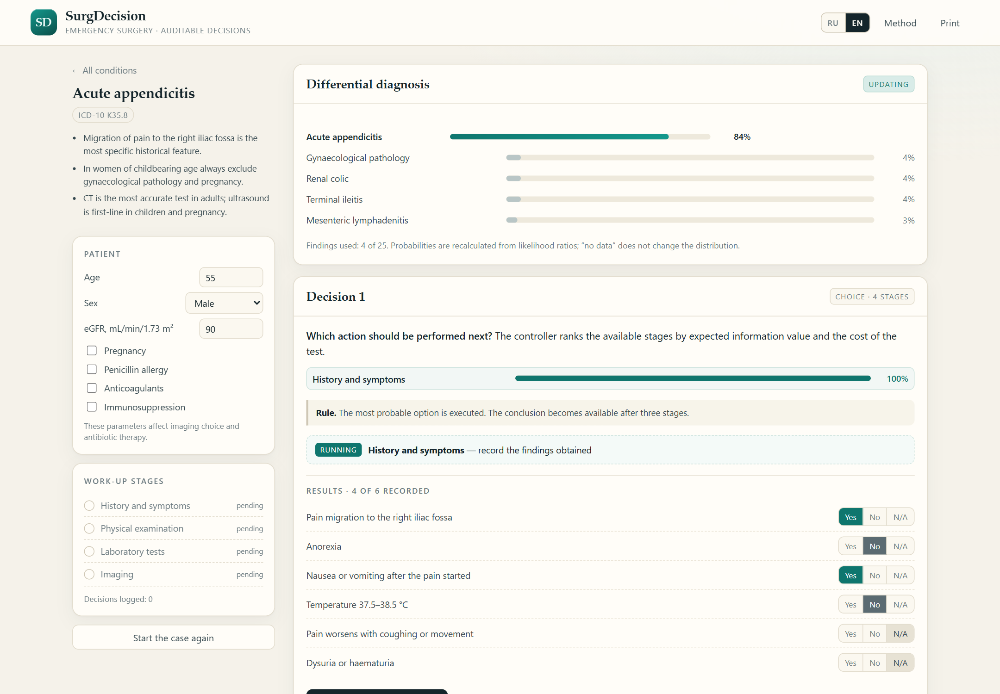
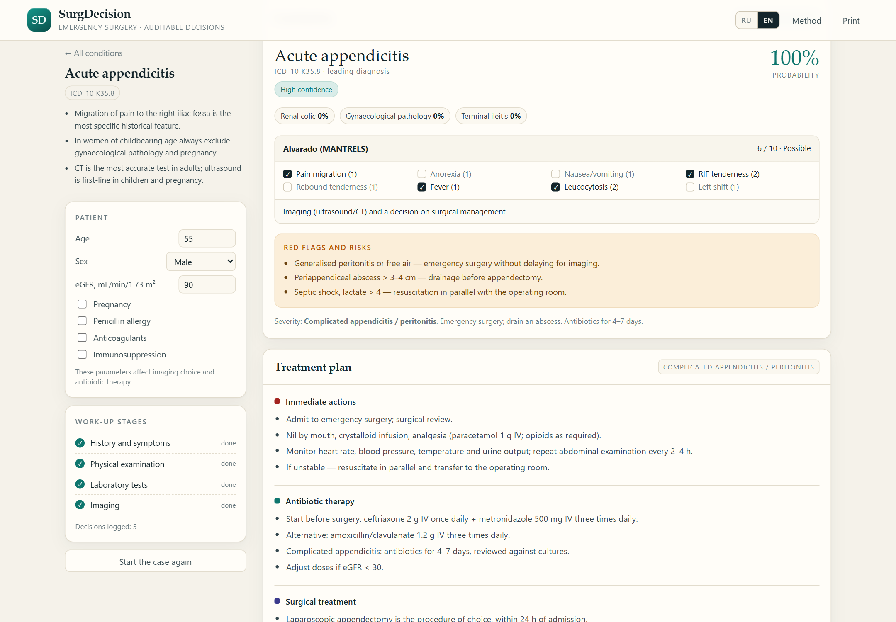

# SurgDecision

**Русский** · [English](#english)

Демонстрационная система поддержки врачебных решений в экстренной хирургии: десять неотложных состояний, типизированный путь обследования, байесовский дифференциальный диагноз, профильные шкалы тяжести и план лечения.

**Открыть приложение:** https://adrenolitik.github.io/SurgDecision/

> Учебно-демонстрационный инструмент. Не является медицинским изделием, не заменяет осмотр хирурга и локальные протоколы. Дозы приведены для взрослых с нормальной функцией почек.



## Возможности

- **10 неотложных состояний:** острый аппендицит, острый холецистит, острый панкреатит, острый дивертикулит, ущемлённая грыжа, перфоративная и кровоточащая пептическая язва, острый мезентериальный тромбоз, острая кишечная непроходимость, травма живота.
- **Типизированный шаг вместо свободного текста.** На каждом этапе — вопрос с закрытым списком вариантов, вероятность каждого варианта, правило выбора и запись в журнал.
- **Дифференциальный диагноз по теореме Байеса.** Для каждого признака задана пара отношений правдоподобия (LR+ и LR−); ответ «нет данных» не меняет распределение.
- **Профильные шкалы:** Alvarado, Tokyo 2018, BISAP, Hinchey, Boey, Glasgow–Blatchford, индекс странгуляции, перитонеальные признаки при ишемии.
- **План лечения по степени тяжести** с поправками на аллергию на пенициллин, беременность, СКФ и антикоагулянты.
- **Аудируемый журнал** всех решений и экспорт случая в JSON.
- **Два языка** — русский и английский, с переключателем и автоопределением по языку браузера; выбор запоминается.



## Как это работает

1. Выберите состояние и при необходимости уточните параметры пациента.
2. Отмечайте полученные данные: «да», «нет» или «нет данных». Дифференциал пересчитывается сразу.
3. Контроллер ранжирует доступные этапы по ожидаемой информационной ценности и стоимости метода; выполняется вариант с наибольшей вероятностью.
4. После трёх этапов доступно заключение: ведущий диагноз, уверенность, красные флаги, шкала и план лечения.
5. Журнал можно изучить полностью или скачать в JSON.



## Языки

Язык выбирается в шапке (RU / EN). При первом открытии приложение берёт сохранённый выбор, иначе — первый поддерживаемый язык из `navigator.languages`, иначе английский. Переключение не сбрасывает ответы: журнал и заключение переводятся на месте.

## Локальный запуск

Проект не требует сборки и зависимостей — это статические файлы.

```bash
python -m http.server 5173 --bind 127.0.0.1
```

Откройте http://127.0.0.1:5173.

## Структура

| Файл | Назначение |
| --- | --- |
| `index.html` | Разметка и подключение скриптов |
| `styles.css` | Оформление, адаптив, печать |
| `data.js` | Русские клинические данные: признаки, LR, шкалы, планы |
| `data.en.js` | Английские тексты; числовые таблицы берутся из `data.js` |
| `i18n.js` | Словари интерфейса, определение и переключение языка |
| `app.js` | Движок решений, расчёты, рендер и экспорт |

---

<a id="english"></a>

# SurgDecision — English

[**Russian**](#surgdecision) · **English**

A demonstration clinical decision-support tool for emergency surgery: ten acute conditions, a typed work-up path, Bayesian differential diagnosis, condition-specific severity scores and a treatment plan.

**Live app:** https://adrenolitik.github.io/SurgDecision/

> An educational demonstration tool. It is not a medical device and does not replace surgical assessment or local protocols. Doses are for adults with normal renal function.



## Features

- **10 emergency conditions:** acute appendicitis, acute cholecystitis, acute pancreatitis, acute diverticulitis, incarcerated hernia, perforated and bleeding peptic ulcer, acute mesenteric ischaemia, acute intestinal obstruction and abdominal trauma.
- **A typed step instead of prose.** Every stage is a question with a closed list of options, a probability for each option, a selection rule and a log entry.
- **Bayesian differential diagnosis.** Each finding has a pair of likelihood ratios (LR+ and LR−); “no data” does not change the distribution.
- **Condition-specific scores:** Alvarado, Tokyo 2018, BISAP, Hinchey, Boey, Glasgow–Blatchford, strangulation index and peritoneal signs in ischaemia.
- **Treatment plan by severity**, adjusted for penicillin allergy, pregnancy, eGFR and anticoagulants.
- **Auditable decision log** and JSON export of the case.
- **Two languages** — Russian and English — with a switcher and browser-language detection; the choice is remembered.



## How it works

1. Choose a condition and adjust the patient parameters if needed.
2. Record the findings obtained: “yes”, “no” or “no data”. The differential is recalculated immediately.
3. The controller ranks the available stages by expected information value and the cost of the test; the most probable option is executed.
4. After three stages the conclusion becomes available: leading diagnosis, confidence, red flags, score and treatment plan.
5. The full log can be reviewed or downloaded as JSON.



## Languages

Choose the language in the header (RU / EN). On first load the app uses the saved choice, otherwise the first supported language from `navigator.languages`, otherwise English. Switching language keeps the answers: the log and conclusion are re-localised in place.

## Run locally

No build step and no dependencies — the app is plain static files.

```bash
python -m http.server 5173 --bind 127.0.0.1
```

Open http://127.0.0.1:5173.

## Structure

| File | Purpose |
| --- | --- |
| `index.html` | Markup and script order |
| `styles.css` | Layout, responsive rules, print styles |
| `data.js` | Russian clinical content: findings, LRs, scores, plans |
| `data.en.js` | English text; numeric tables stay in `data.js` |
| `i18n.js` | UI dictionaries, language detection and switching |
| `app.js` | Decision engine, calculations, rendering and export |
